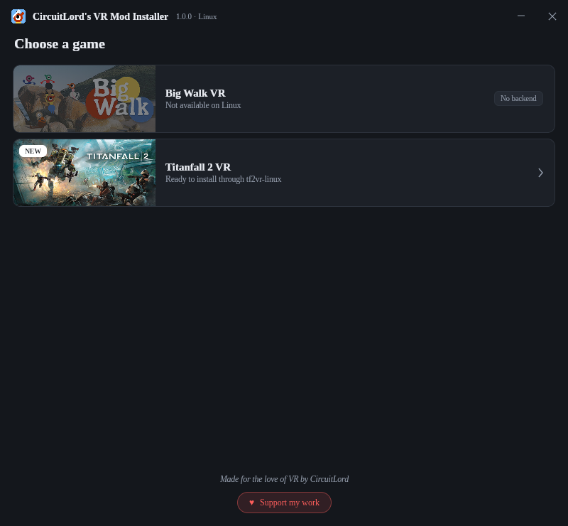

# CircuitLord's VR Mod Installer — Linux (beta)

A native Linux desktop port of [CircuitLord's VR Mod Installer](https://github.com/CircuitLord/CircuitLordVRModInstaller).
The original WPF interface is recreated in .NET 10 + Avalonia, so it runs without Wine.

Titanfall 2 VR installation is delegated to [Monkellie's `tf2vr-linux`](https://github.com/Monkellie/tf2vr-linux):
this app manages a checkout of that repository, runs its real `install.sh`, and does not reimplement
Proton setup, downloads, checksums or the mod layout. Big Walk VR is shown for parity with the
original but is unavailable on Linux because no backend exists for it.

[**Download the beta**](https://github.com/polar421/CircuitLordVRModInstaller-linuxinstaller/releases)
· [Build from source](#build-from-source) · [Documentation](#documentation)



> **Beta:** the UI, backend management and packaging are usable, but a full install has not been
> exercised end-to-end against a real Titanfall 2 install, and the Steam integration has only been
> fixture-tested. See [Status](#status) and [Limitations](#limitations) before relying on it.

## Install the prebuilt release

The release archive is **self-contained** (no .NET runtime required) and installs entirely in your
user account — no root, no system files.

Requirements: glibc-based **x86-64** Linux with a desktop session, plus `git`, `bash`, `curl` and
`python3` for the backend. Steam, SteamVR, WiVRn or Monado are needed only for the integrations you
use.

```bash
# 1. Download the archive and its checksum from the latest release page.
#    https://github.com/polar421/CircuitLordVRModInstaller-linuxinstaller/releases

# 2. Verify the download (replace the file name if the version differs).
sha256sum -c circuitlord-vrmodinstaller-1.0.0-linux-x64.tar.gz.sha256

# 3. Extract and install for the current user.
tar -xzf circuitlord-vrmodinstaller-1.0.0-linux-x64.tar.gz
./circuitlord-vrmodinstaller-1.0.0-linux-x64/install.sh
```

This creates:

| Item | Path |
|---|---|
| Application | `${XDG_DATA_HOME:-~/.local/share}/circuitlord-vrmodinstaller/app` |
| Command | `~/.local/bin/circuitlord-vrmodinstaller` |
| Menu entry | `${XDG_DATA_HOME:-~/.local/share}/applications/circuitlord-vrmodinstaller.desktop` |
| Icons | `${XDG_DATA_HOME:-~/.local/share}/icons/hicolor/<size>/apps/circuitlord-vrmodinstaller.png` |

Start it from your application menu or run `circuitlord-vrmodinstaller` (if `~/.local/bin` is on
`PATH`). To remove the app, run the same archive's installer with `--uninstall`; it keeps the
managed backend checkout, settings, logs, the `tf2vr` launcher and the installed mod.

The installer verifies every packaged file against `SHA256SUMS` before writing anything and aborts
on a mismatch or an unsafe checksum path.

## Status

| Area | Status |
|---|---|
| Native Linux UI (Avalonia, no Wine) | Implemented; original layout, serif typography, icon title bar, NEW badge and support footer |
| Managed `tf2vr-linux` checkout with origin verification and safe update | Implemented |
| Live catalogue from `install.sh --list-versions` | Implemented, exercised against the real backend (19 entries) |
| Stable/beta mapping (choice 1 → `latest`, 2 → `beta`, other ordinals → exact token) | Implemented and unit tested |
| Install / reinstall / uninstall through `install.sh` | Implemented; not yet run end-to-end against a real Titanfall 2 installation |
| Preflight (`install.sh --check`) | Implemented |
| Launch through the installed native `tf2vr` launcher | Implemented |
| WiVRn desktop entry with `Categories=Game;X-WiVRn-VR;` | Implemented, reconciled after install |
| Steam shortcut with graceful close → backup → verified write → reopen | Implemented and fixture tested; not verified against a live Steam client |
| Manifest release notes | Implemented (HTTPS, cache, validation) |
| Reproducible self-contained release + user-level installer | Implemented; see `docs/RELEASE.md` |
| Automated tests | 33 passing |

## Limitations

- **Beta quality.** Core flows exist, but real-game/Steam/WiVRn behavior has not been confirmed on
  a machine with Titanfall 2 installed. Treat installation and Steam changes as untested paths.
- **x86-64 only.** No arm64 build, AppImage, Flatpak or distribution package.
- **Wayland tested via XWayland only.** Native Wayland was not exercised; X11 behavior was.
- Background downloads, pause/resume and an in-app updater are not implemented.
- No first-run wizard, settings screen, dedicated diagnostics page or installation history UI.

## Build from source

Requirements: Linux x86-64 and the .NET SDK **10.0.114** (pinned in `global.json`). NuGet packages
are locked; restore runs with `--locked-mode`.

```bash
dotnet restore CircuitLord.VRModInstaller.Linux.slnx --locked-mode
dotnet build CircuitLord.VRModInstaller.Linux.slnx -c Release
dotnet test tests/CircuitLord.VRModInstaller.Core.Tests -c Release

# Run the app from the build tree
dotnet run --project src/CircuitLord.VRModInstaller.App

# Build the self-contained release archive
packaging/build-release.sh
```

The packaging script publishes for `linux-x64`, stages the app, icons, menu-entry template and
installer, verifies that no game/mod content is present, and writes a deterministic tarball plus
`SHA256SUMS` and a `.tar.gz.sha256` file. Two clean builds of the same commit produce the same
archive hash; exact commands and the measured hash are in `docs/RELEASE.md`.

## Safety guarantees

- The release installer verifies every file against the archive's `SHA256SUMS` before installing,
  and rejects absolute or `..` paths in the checksum list.
- The normal Titanfall 2 installation and its Steam entry are never modified.
- `shortcuts.vdf` is never written while the selected Steam client is running; it is backed up,
  written to a same-directory temporary file, re-parsed and atomically committed.
- If this application shuts Steam down, it attempts to reopen the same installation even when the
  shortcut write fails. Steam is never force-killed.
- The active OpenXR runtime is never changed and SteamVR is never forced.
- Only the backend's own uninstall operation removes game files; campaign saves are untouched.

## Documentation

- [`docs/RELEASE.md`](docs/RELEASE.md) — build, package, install and reproducibility details
- [`docs/ARCHITECTURE.md`](docs/ARCHITECTURE.md) — components and data locations
- [`docs/BACKEND_CONTRACT.md`](docs/BACKEND_CONTRACT.md) — how the app drives `tf2vr-linux`
- [`docs/TEST_PLAN.md`](docs/TEST_PLAN.md) — automated and manual verification results
- [`docs/PROJECT_AUDIT.md`](docs/PROJECT_AUDIT.md) — feature-by-feature audit against the original
- [`docs/TROUBLESHOOTING.md`](docs/TROUBLESHOOTING.md) — common failures and fixes

## License

This installer is MIT licensed; see [LICENSE](LICENSE) and [THIRD-PARTY-NOTICES.md](THIRD-PARTY-NOTICES.md).
The bundled serif font is Liberation Serif under the SIL Open Font License 1.1. Game names and
artwork belong to their respective owners; no game or mod content is distributed here. This project
is not affiliated with or endorsed by Respawn Entertainment or Electronic Arts.
