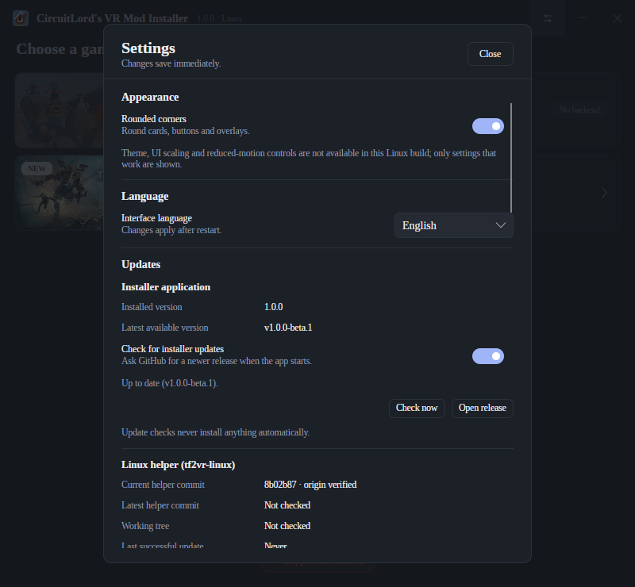

# CircuitLord's VR Mod Installer — Unofficial Linux Port (beta)

This is an **unofficial Linux port** of [CircuitLord's VR Mod Installer](https://github.com/CircuitLord/CircuitLordVRModInstaller).
The original WPF interface is recreated in .NET 10 + Avalonia, so it runs without Wine.

> **Unofficial Linux port.** This project is independently developed and is not made, developed,
> published, endorsed, or officially supported by CircuitLord. The original VR Mod Installer was
> created by CircuitLord for Windows. Titanfall 2 VR installation uses Monkellie's `tf2vr-linux`
> project as its Linux backend.

Titanfall 2 VR installation is delegated to [Monkellie's `tf2vr-linux`](https://github.com/Monkellie/tf2vr-linux):
this app manages a checkout of that repository, runs its real `install.sh`, and does not reimplement
Proton setup, downloads, checksums or the mod layout. Big Walk VR is shown for parity with the
original but is unavailable on Linux because no backend exists for it.

[**Download the beta**](https://github.com/polar421/CircuitLordVRModInstaller-linuxinstaller/releases/tag/v1.0.9-beta.3)
· [Build from source](#build-from-source) · [Documentation](#documentation)




> **Beta:** the UI, backend management and packaging are usable, but a full install has not been
> exercised end-to-end against a real Titanfall 2 install, and the Steam integration has only been
> fixture-tested. See [Status](#status) and [Limitations](#limitations) before relying on it.
>
> Native Wayland, the settings screen and automatic installer updates are included in the
> latest `v1.0.9-beta.3` release.

## Install the prebuilt release

The release archive is **self-contained** (no .NET runtime required) and installs entirely in your
user account — no root, no system files.

Requirements: glibc-based **x86-64** Linux with an X11 or Wayland desktop session, plus `git`,
`bash`, `curl` and `python3` for the backend. Native Wayland is used when a compositor is available
(Avalonia 12.1, experimental); otherwise the app falls back to X11. Steam, SteamVR, WiVRn or Monado
are needed only for the integrations you use.

```bash
# 1. Download the archive and its checksum from:
#    https://github.com/polar421/CircuitLordVRModInstaller-linuxinstaller/releases/tag/v1.0.9-beta.3

# 2. Verify the download.
sha256sum -c circuitlord-vrmodinstaller-1.0.9-beta.3-linux-x64.tar.gz.sha256

# 3. Extract and install for the current user.
tar -xzf circuitlord-vrmodinstaller-1.0.9-beta.3-linux-x64.tar.gz
./circuitlord-vrmodinstaller-1.0.9-beta.3-linux-x64/install.sh
```

This creates:

| Item | Path |
|---|---|
| Application | `${XDG_DATA_HOME:-~/.local/share}/circuitlord-vrmodinstaller/app` |
| Command | `~/.local/bin/circuitlord-vrmodinstaller` |
| Menu entry | `${XDG_DATA_HOME:-~/.local/share}/applications/circuitlord-vrmodinstaller.desktop` |
| Icons | `${XDG_DATA_HOME:-~/.local/share}/icons/hicolor/<size>/apps/circuitlord-vrmodinstaller.png` |

Start it from your application menu or run `circuitlord-vrmodinstaller` (if `~/.local/bin` is on
`PATH`). To remove the app, run the same archive's installer with `--uninstall`; it keeps the
managed backend checkout, settings, logs, the `tf2vr` launcher and the installed mod.

The installer verifies every packaged file against `SHA256SUMS` before writing anything and aborts
on a mismatch or an unsafe checksum path.

## Status

| Area | Status |
|---|---|
| Native Linux UI (Avalonia, no Wine) | Implemented; original layout, serif typography, icon title bar, NEW badge and support footer |
| Native Wayland with X11 fallback | Implemented on Avalonia 12.1; exercised on KWin Wayland and X11 |
| Settings screen (General, Appearance, Diagnostics and About tabs, fixed Restore Defaults footer) | Implemented; preferences persist in `settings.json` schema 8 |
| Appearance | System/Dark/Light themes, Compact/Comfortable density, 80–150% UI scaling in 5% steps, and Follow system/Reduced/Full motion, applied live and persisted |
| Interface languages | English, German, Spanish, French, Brazilian Portuguese, Italian, Polish, Russian, Japanese and Simplified Chinese; see [`docs/LOCALIZATION.md`](docs/LOCALIZATION.md) |
| Automatic installer updates and helper updates | Implemented; stable/beta update channels filter prereleases, release archives are checksum-verified and applied by a detached helper; helper updates remain origin-verified |
| Managed `tf2vr-linux` checkout with origin verification and safe update | Implemented |
| Live catalogue from `install.sh --list-versions` | Implemented, exercised against the real backend (19 entries) |
| Stable/beta mapping (choice 1 → `latest`, 2 → `beta`, other ordinals → exact token) | Implemented and unit tested |
| Install / reinstall / uninstall through `install.sh` | Implemented; not yet run end-to-end against a real Titanfall 2 installation |
| Preflight (`install.sh --check`) | Implemented |
| First-run setup wizard | Implemented; nine guided steps for game, backend, Proton/dependencies, OpenXR, WiVRn, Steam and release choice, with automatic skips and a Settings relaunch |
| Titanfall 2 navigation | Dedicated Overview, Releases, History and Diagnostics tabs with preserved per-tab state, independent scrolling, keyboard navigation, localized labels and a background-operation indicator |
| Installation history | Dedicated page with date, previous/new version, channel, operation type, result, backend commit, duration and linked log; search, date sorting and operation/result filters for install, update, reinstall, repair and uninstall |
| Release explorer | Dedicated browser in the Releases tab with local search across versions, channels, descriptions and changelogs; Stable/Beta/Pinned/Installed/Selected filters; semantic sorting; release details with manifest metadata; exact changelog differences; and backend-token selection |
| Installer controls | Copy buttons beside installed/latest versions and technical paths, a title-bar busy indicator, an install confirmation preview, and searchable operation logs in Diagnostics |
| Notification center | Title-bar activity bell with unread count and a persistent panel for installs, failures, releases, helper updates, Steam integration and WiVRn desktop-entry issues |
| Contextual help | Small `?` popovers beside release channels, pinned releases, Proton-TF2VR, WiVRn repair, Steam restart and rebuild controls |
| Launch through the installed native `tf2vr` launcher | Implemented |
| WiVRn desktop entry with `Categories=Game;X-WiVRn-VR;` | Implemented, reconciled after install |
| Steam shortcut with graceful close → backup → verified write → reopen | Implemented and fixture tested; not verified against a live Steam client |
| Manifest release notes | Implemented (HTTPS, cache, validation) |
| Reproducible self-contained release + user-level installer | Implemented; see `docs/RELEASE.md` |
| Automated tests | 168 passing (including headless Settings UI tests) |

## Limitations

- **Beta quality.** Core flows exist, but real-game/Steam/WiVRn behavior has not been confirmed on
  a machine with Titanfall 2 installed. Treat installation and Steam changes as untested paths.
- **x86-64 only.** No arm64 build, AppImage, Flatpak or distribution package.
- **Native Wayland is experimental in Avalonia 12.1.** It was exercised on KWin; other
  compositors may expose backend gaps. The app falls back to X11 when no Wayland compositor is
  reachable.
- **Automatic updates require an installed release.** Running from the build tree or `dotnet run`
  is never replaced. The updater downloads a newer Linux release archive, verifies its SHA-256 and
  the archive's internal `SHA256SUMS`, then lets a detached helper wait for the app to exit,
  install and relaunch it. A failed install leaves the previous app in place.
- **Raw technical output stays in its original language.** Backend command output, git messages,
  release notes and technical paths are deliberately not rewritten. The ten UI catalogs cover
  every application-owned label, dialog and status string.

## Build from source

Requirements: Linux x86-64 and the .NET SDK **10.0.114** (pinned in `global.json`). NuGet packages
are locked; restore runs with `--locked-mode`.

```bash
dotnet restore CircuitLord.VRModInstaller.Linux.slnx --locked-mode
dotnet build CircuitLord.VRModInstaller.Linux.slnx -c Release
dotnet test CircuitLord.VRModInstaller.Linux.slnx -c Release

# Run the app from the build tree
dotnet run --project src/CircuitLord.VRModInstaller.App

# Build the self-contained release archive
packaging/build-release.sh
```

The packaging script publishes for `linux-x64`, stages the app, icons, menu-entry template and
installer, verifies that no game/mod content is present, and writes a deterministic tarball plus
`SHA256SUMS` and a `.tar.gz.sha256` file. Two clean builds of the same commit produce the same
archive hash; exact commands and the measured hash are in `docs/RELEASE.md`.

## Safety guarantees

- The release installer verifies every file against the archive's `SHA256SUMS` before installing,
  and rejects absolute or `..` paths in the checksum list.
- The normal Titanfall 2 installation and its Steam entry are never modified.
- `shortcuts.vdf` is never written while the selected Steam client is running; it is backed up,
  written to a same-directory temporary file, re-parsed and atomically committed.
- If this application shuts Steam down, it attempts to reopen the same installation even when the
  shortcut write fails. Steam is never force-killed.
- The active OpenXR runtime is never changed and SteamVR is never forced.
- Only the backend's own uninstall operation removes game files; campaign saves are untouched.

## Documentation

- [`docs/RELEASE.md`](docs/RELEASE.md) — build, package, install and reproducibility details
- [`docs/ARCHITECTURE.md`](docs/ARCHITECTURE.md) — components and data locations
- [`docs/BACKEND_CONTRACT.md`](docs/BACKEND_CONTRACT.md) — how the app drives `tf2vr-linux`
- [`docs/TEST_PLAN.md`](docs/TEST_PLAN.md) — automated and manual verification results
- [`docs/PROJECT_AUDIT.md`](docs/PROJECT_AUDIT.md) — feature-by-feature audit against the original
- [`docs/TROUBLESHOOTING.md`](docs/TROUBLESHOOTING.md) — common failures and fixes

## Attribution and license

- **Original VR Mod Installer:** created by **CircuitLord** for Windows:
  <https://github.com/CircuitLord/CircuitLordVRModInstaller>. The installer source is MIT licensed.
- **Linux backend:** **Monkellie's** `tf2vr-linux`: <https://github.com/Monkellie/tf2vr-linux>,
  MIT licensed. It is cloned at runtime and is not redistributed in this project.
- **This Linux port:** independently developed and maintained by the Linux-port contributors. The
  Avalonia interface, Linux orchestration, packaging and update code are separate from CircuitLord's
  original WPF application. The original application's name, visual identity and artwork remain
  CircuitLord's work and are reused under the original MIT license.
- **Mod packages:** not covered by the installer's MIT license and not redistributed here.

See [LICENSE](LICENSE) and [THIRD-PARTY-NOTICES.md](THIRD-PARTY-NOTICES.md) for the complete
notices. The bundled serif font is Liberation Serif and the CJK fallbacks are Noto Sans CJK, both
under the SIL Open Font License 1.1. Game names
and artwork belong to their respective owners; no game or mod content is distributed here. This
project is not affiliated with or endorsed by Respawn Entertainment or Electronic Arts.
